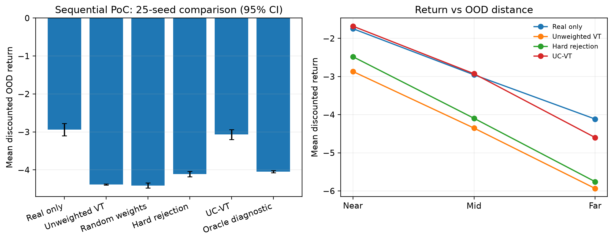

# UC-VT Meta-RL

### Uncertainty-Calibrated Virtual Training for Out-of-Distribution Meta-Reinforcement Learning

[](https://www.python.org/)
[](https://pytorch.org/)
[](https://gymnasium.farama.org/environments/mujoco/)
[](ucvt_paper_revised.pdf)

UC-VT makes virtual-task training safer under distribution shift. It augments a meta-RL agent with an ensemble task decoder, uses ensemble disagreement as epistemic uncertainty, and softly down-weights synthetic transitions that are likely to produce unreliable Bellman targets.

This repository contains:

- a reproducible, CPU-friendly multi-step proof of concept using Fitted-Q Iteration;
- a deep continuous-control implementation built from SAC and TAVT-style components;
- OOD task families for reward shift (`HalfCheetah-v5`) and transition shift (`Walker2d-v5`);
- raw training/evaluation logs, generated figures, and the full project paper.

> **Research status:** the uncertainty-weighting mechanism is strongly supported by the 25-seed sequential experiment. The deep-RL experiment is a single-seed pilot: it performs well in the matched early window but becomes unstable during extended training. The repository preserves both the positive result and the failure mode.

## Why UC-VT?

Virtual tasks can widen the training distribution of a meta-RL agent without additional environment interaction. The problem is that a learned decoder may generate incorrect rewards or next states when asked to extrapolate beyond the real training tasks. Treating every generated transition equally can then bias the critic.

UC-VT replaces that all-or-nothing choice with a confidence-weighted virtual loss:

```text
ensemble disagreement  u
          │
          ▼
confidence w(u) = exp(-βu / cₜ)
          │
          ▼
Lcritic = Lreal + λᵥ E[w(u) Lvirtual]
```

Here, `cₜ` is a running uncertainty percentile. Reliable synthetic samples retain influence, while uncertain ones are smoothly suppressed.

## Main result

The sequential experiment evaluates seven training strategies on near-, mid-, and far-OOD tasks over 25 random seeds. Higher return is better.

| Method | Mean discounted OOD return |
|---|---:|
| Real only | **-2.939 ± 0.413** |
| Unweighted virtual training | -4.386 ± 0.040 |
| Uniform matched mass | -4.396 ± 0.085 |
| Random weights | -4.411 ± 0.176 |
| Hard rejection | -4.112 ± 0.184 |
| **UC-VT** | **-3.069 ± 0.338** |
| Oracle diagnostic | -4.045 ± 0.075 |

UC-VT improves over unweighted virtual training by **+1.317 return** (95% CI `[1.190, 1.443]`, paired `p = 1.14e-16`) and wins on all 25 seeds. Its uncertainty signal remains strongly aligned with true decoder error:

- Pearson correlation: `0.802 ± 0.132`
- Spearman correlation: `0.885 ± 0.027`

Against real-only training, UC-VT is statistically indistinguishable in this tier (`p = 0.159`). The central result is therefore about **making virtual training safer**, not claiming a universal improvement over a strong real-data baseline.



## Deep-RL pilot

The deep implementation combines:

- a permutation-invariant context encoder for task inference;
- an independently initialized ensemble of reward/transition decoders;
- a tanh-Gaussian SAC actor and twin Q critics;
- a bisimulation-style task-preserving objective;
- latent-state smoothness regularization;
- uncertainty-weighted virtual critic updates;
- resumable checkpoints, mixed precision, CSV logging, and OOD evaluation.

In the matched evaluation window (iterations 1500–1950), UC-VT achieves a mean OOD discounted return of `-171.48`, compared with `-176.31` for real-only and `-181.72` for unweighted virtual training. These are single-seed pilot results and are not statistically conclusive.

Extended UC-VT training later exhibits large virtual Bellman-loss spikes and critic divergence. This is consistent with the ensemble becoming confidently wrong at extrapolated latents. A calibration-gated virtual-task curriculum is the highest-priority next step.

## Repository layout

```text
.
├── README.md
├── CITATION.cff
├── requirements.txt
├── ucvt_paper_revised.pdf
├── multi_step_env/
│   ├── ucvt_sequential_poc_new.py
│   └── poc_seq_output/
│       ├── results.json
│       ├── summary.txt
│       └── ucvt_sequential_poc.png
└── full_deep_RL_setup/
    ├── codes/ucvt_deep/
    │   ├── algorithm.py
    │   ├── buffers.py
    │   ├── config.py
    │   ├── envs.py
    │   ├── evaluate.py
    │   ├── losses.py
    │   ├── networks.py
    │   ├── train.py
    │   └── utils/checkpoint.py
    └── results/logs/
```

## Quick start

Python 3.10 or 3.11 is recommended.

```bash
git clone https://github.com/OWNER/ucvt-meta-rl.git
cd ucvt-meta-rl

python -m venv .venv
source .venv/bin/activate          # Windows: .venv\Scripts\activate
python -m pip install --upgrade pip
pip install -r requirements.txt
```

### Reproduce the sequential experiment

The default run uses 25 seeds and writes the summary, JSON results, and plot to the specified output directory.

```bash
python multi_step_env/ucvt_sequential_poc_new.py \
  --seeds 25 \
  --output-dir multi_step_env/poc_seq_output
```

For a quick check:

```bash
python multi_step_env/ucvt_sequential_poc_new.py \
  --seeds 2 \
  --output-dir /tmp/ucvt-smoke
```

### Run the complete deep pipeline

Start with the smoke test. It exercises rollout collection, gradient updates, evaluation, logging, and checkpointing end to end.

```bash
cd full_deep_RL_setup/codes/ucvt_deep

python train.py --smoke_test --task_family cheetah_vel
python train.py --smoke_test --task_family walker_mass
```

Then launch a full run:

```bash
python train.py --task_family cheetah_vel --total_iterations 2000
# or
python train.py --task_family walker_mass --total_iterations 2000
```

Resume the newest checkpoint:

```bash
python train.py --task_family cheetah_vel --total_iterations 2000 --resume
```

Evaluate a saved model across train/near/mid/far task bins:

```bash
python evaluate.py --checkpoint best --task_family cheetah_vel
```

The code automatically uses CUDA when available. The full MuJoCo experiment is best run on a GPU environment such as Kaggle; the sequential experiment is CPU-only.

## Task families

| Family | Base environment | Distribution shift | Task parameter |
|---|---|---|---|
| `cheetah_vel` | `HalfCheetah-v5` | Reward | Target forward velocity |
| `walker_mass` | `Walker2d-v5` | Transition dynamics | Body-mass multiplier |

Both wrappers expose `set_task(z)`. Evaluation samples progressively more distant `near`, `mid`, and `far` OOD bins defined in `envs.py`.

## Reproducibility notes

- The published sequential artifacts were generated with 25 seeds, horizon 6, discount `γ = 0.9`, 10 real tasks, and 41 virtual tasks.
- The deep logs contain a 4000-iteration UC-VT run and 2000-iteration real-only/unweighted baselines. The paper compares them only over their shared window.
- Tier-3 results use one seed per method and should be interpreted as a feasibility study.
- The code uses modern Gymnasium and native MuJoCo instead of the legacy `gym`/`mujoco-py` stack required by the original TAVT implementation.
- The deep implementation intentionally omits TAVT's WGAN refinement and context-distribution VAE; its state regularizer is a simpler Lipschitz-style penalty.
- Actor updates use real transitions only. Virtual transitions affect the critic through UC-VT weighting.

## Roadmap

- [ ] Add a calibration-gated curriculum for the virtual-task radius.
- [ ] Repeat every deep-RL condition with multiple seeds and matched budgets.
- [ ] Complete the `walker_mass` transition-shift study.
- [ ] Report CVaR, critic-target bias, and uncertainty calibration curves.
- [ ] Reintroduce the omitted TAVT components and measure their effect on stability.

## Paper and citation

The complete eight-page report is available as [Uncertainty-Calibrated Virtual Training for Out-of-Distribution Meta-Reinforcement Learning](ucvt_paper_revised.pdf).

If this repository helps your work, please cite it using [`CITATION.cff`](CITATION.cff):

```bibtex
@misc{ghias2026ucvt,
  title  = {Uncertainty-Calibrated Virtual Training for Out-of-Distribution Meta-Reinforcement Learning},
  author = {Ghias, Sepehr and Norouzi Manesh, Parsa and Mansouri, Alireza},
  year   = {2026},
  note   = {Deep Reinforcement Learning course project}
}
```

## Acknowledgements

UC-VT builds on ideas from **Task-Aware Virtual Training (TAVT)**, **Latent Dynamics Mixture**, deep ensembles, and Soft Actor-Critic. See the paper for the complete discussion and references.

